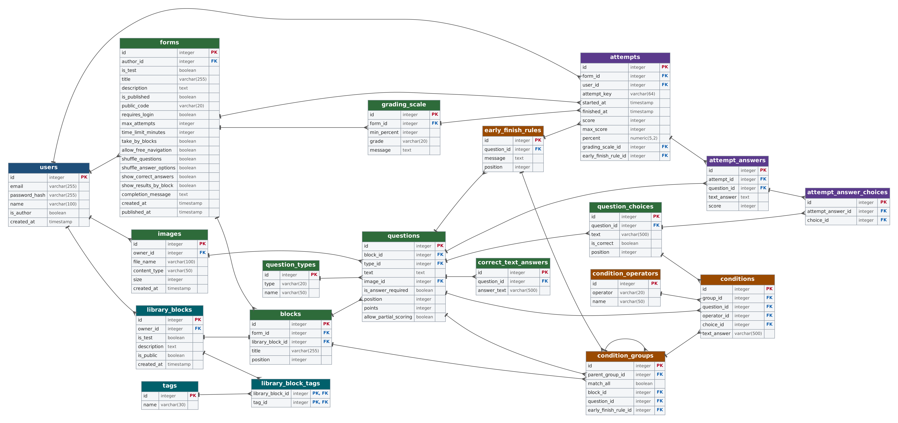

# Схема базы данных

*Веб-конструктор опросов и тестов (Vue 3, FastAPI, PostgreSQL). Версия 4*

## 1. Общая идея

Опросы и тесты хранятся в **одних и тех же таблицах**. Они различаются полем `is_test` в таблице `forms`. Всё, что нужно только опросам (условия показа), или только тестам (баллы, правильные ответы, шкала оценок, режимы прохождения), вынесено в отдельные поля и таблицы и не используется там, где не требуется. Благодаря этому не нужно дублировать код и таблицы.

В базе **19 таблиц**, они делятся на пять групп (цвета на диаграмме):

| Группа | Таблицы |
|---|---|
| **Пользователи** | `users` |
| **Опросы и тесты** | `forms`, `blocks`, `questions`, `question_types`, `question_choices`, `correct_text_answers`, `images`, `grading_scale` |
| **Условия показа и досрочное завершение (только опросы)** | `condition_groups`, `conditions`, `condition_operators`, `early_finish_rules` |
| **Прохождения и ответы** | `attempts`, `attempt_answers`, `attempt_answer_choices` |
| **Библиотека блоков** | `library_blocks`, `tags`, `library_block_tags` |

### Принятые решения, от которых зависит структура

- **Два типа пользователей.** Поле `users.is_author`: true для составителя, false для участника. Роль задаётся при регистрации и не меняется.
- **Двузначные признаки хранятся булевыми полями** (`is_author`, `is_test`, `is_published`, `requires_login`). Значение нельзя записать с ошибкой, и не нужны отдельные справочники из двух строк.
- **Типы вопросов и операторы условий вынесены в справочники** (`question_types` и `condition_operators`), а в `questions` и `conditions` лежат внешние ключи `type_id` и `operator_id`. Справочники заполняются в миграции Alembic; в JSON API по-прежнему используются текстовые коды (single, chosen и т. д.).
- **Анонимное прохождение.** Если участник не авторизован, в попытке поле `user_id` пустое.
- **Блоки есть у опросов и у тестов.** У каждой формы минимум один блок, название блока необязательно. Скрытого блока у теста больше нет.
- **Режимы прохождения одинаковы у опросов и тестов.** `take_by_blocks`: страница равна блоку или один вопрос на экране; `allow_free_navigation`: можно ли возвращаться и переходить по блокам или вопросам. Четыре сочетания описаны в документе по API.
- **Текст без вопроса.** Тип вопроса `info`: пояснение между вопросами. Не нумеруется, баллов и ответов у него нет.
- **Картинки.** К вопросу можно прикрепить одну картинку (таблица `images`, поле `questions.image_id`). Видео и картинки в вариантах ответа в первой версии не поддерживаются.
- **Баллы целые.** Дробные частичные баллы за вопрос округляются вниз, чтобы полный балл получал только полностью верный ответ.
- **Оценка в попытке** хранится как ссылка на строку шкалы (`attempts.grading_scale_id`), отдельной таблицы оценок нет.
- **Условия показа** есть только у опросов и привязаны к самому блоку или вопросу (как в Яндекс Формах). Группы условий допускают вложенность в будущем, в первой версии используется одна группа со связкой «все» или «любое».
- **Досрочное завершение опроса.** К вопросу опроса можно привязать правила (таблица `early_finish_rules`): если после ответа условие правила выполнено, опрос заканчивается сразу, а в попытке запоминается правило (`attempts.early_finish_rule_id`). Условие правила хранится в тех же таблицах, что и условия показа (`condition_groups` и `conditions`), связь через `condition_groups.early_finish_rule_id`.
- **Сообщения на странице завершения** можно задать в трёх местах: `forms.completion_message` (общее), `grading_scale.message` (для оценки в тесте) и `early_finish_rules.message` (для правила досрочного завершения). Участнику показывается одно, первое из заполненных в этом порядке: правило, оценка, форма; если ничего нет, стандартный текст «Спасибо за участие!».
- **Опубликованные формы не редактируются**, поэтому ответы безопасно ссылаются на вопросы и варианты.
- **Библиотека блоков работает через копирование, а не через ссылки.** При сохранении в библиотеку создаётся **отдельная копия** блока (образец): строка в `blocks` с пустым `form_id` и заполненным `library_block_id`. Блок в самой форме остаётся обычным и о библиотеке не знает. При вставке в форму образец копируется ещё раз. Правка и удаление любой из копий не меняют остальные, поэтому опубликованные формы остаются неизменными, и таблица пар «форма-блок» не нужна.
- **Теги** хранятся в двух таблицах (`tags` и `library_block_tags`): так соблюдается первая нормальная форма, в одной ячейке не лежит список.

## 2. ER-диаграмма

Условные обозначения: **PK** первичный ключ, **FK** внешний ключ. Связь «один ко многим» рисуется чёрточкой на стороне «один» и «вилкой» на стороне «многие»; связь «один к одному» чёрточками с обеих сторон (блок и запись библиотеки).

## 3. Описание таблиц

### 3.1. `users`, Пользователи

Все зарегистрированные пользователи: и составители, и участники. Роль задаётся при регистрации и потом не меняется.

| Поле | Тип | Ключ | Пояснение |
|---|---|---|---|
| `id` | `integer` | **PK** | Первичный ключ |
| `email` | `varchar(255)` |  | Уникальный адрес электронной почты, используется для входа |
| `password_hash` | `varchar(255)` |  | Пароль в зашифрованном виде (сам пароль не хранится) |
| `name` | `varchar(100)` |  | Имя пользователя |
| `is_author` | `boolean` |  | true: составитель, false: участник |
| `created_at` | `timestamp` |  | Дата регистрации |

### 3.2. `forms`, Опросы и тесты

И опрос, и тест хранятся в одной таблице, различаются полем is_test. Режимы прохождения и перемешивание вариантов работают у обоих типов; поля со словом «тесты» в пояснении для опросов остаются выключенными или пустыми.

| Поле | Тип | Ключ | Пояснение |
|---|---|---|---|
| `id` | `integer` | **PK** | Первичный ключ |
| `author_id` | `integer` | **FK** | Составитель, создавший форму (users.id) |
| `is_test` | `boolean` |  | true: тест, false: опрос; после создания не меняется |
| `title` | `varchar(255)` |  | Название |
| `description` | `text` |  | Описание, может быть пустым |
| `is_published` | `boolean` |  | false: черновик, true: опубликован (опубликованную форму нельзя редактировать) |
| `public_code` | `varchar(20)` |  | Случайный уникальный код для ссылки на форму |
| `requires_login` | `boolean` |  | true: только авторизованным, false: всем, в том числе анонимно |
| `max_attempts` | `integer` |  | Максимум попыток; пусто = без ограничений, 1 = один раз |
| `time_limit_minutes` | `integer` |  | Ограничение времени в минутах; пусто = без ограничения (только тесты) |
| `take_by_blocks` | `boolean` |  | Режим прохождения: true: страница равна блоку, false: один вопрос на экране (опросы и тесты) |
| `allow_free_navigation` | `boolean` |  | Разрешить возвращаться назад и переходить между вопросами или блоками (опросы и тесты) |
| `shuffle_questions` | `boolean` |  | Перемешивать вопросы (только тесты): внутри блока или по всему набору, в зависимости от режима |
| `shuffle_answer_options` | `boolean` |  | Перемешивать варианты ответа внутри вопросов (опросы и тесты) |
| `show_correct_answers` | `boolean` |  | Показывать ли правильные ответы после прохождения (только тесты) |
| `show_results_by_block` | `boolean` |  | Показывать ли участнику результат по каждому блоку (только тесты; не зависит от show_correct_answers) |
| `completion_message` | `text` |  | Общее сообщение на странице завершения (простой текст, до 1000 символов, проверяется в API); может быть пустым |
| `created_at` | `timestamp` |  | Дата создания |
| `published_at` | `timestamp` |  | Дата публикации; пусто, пока черновик |

### 3.3. `blocks`, Блоки

Группы вопросов. Блоки есть и у опросов, и у тестов; у каждой формы минимум один блок. Здесь же хранятся блоки-образцы библиотеки: у них form_id пустой, а заполнено library_block_id. У любого блока заполнено ровно одно из этих двух полей.

| Поле | Тип | Ключ | Пояснение |
|---|---|---|---|
| `id` | `integer` | **PK** | Первичный ключ |
| `form_id` | `integer` | **FK** | Форма, которой принадлежит блок (forms.id); пусто у образцов библиотеки |
| `library_block_id` | `integer` | **FK** | Запись библиотеки, для которой этот блок образец (library_blocks.id); уникально; пусто у блоков форм |
| `title` | `varchar(255)` |  | Название блока; в форме необязательно, у образца библиотеки обязательно (это название блока в библиотеке) |
| `position` | `integer` |  | Порядковый номер блока в форме |

### 3.4. `question_types`, Типы вопросов

Справочник из четырёх строк: single (один ответ), multiple (несколько ответов), text (текстовый ответ), info (текст без вопроса). Заполняется в миграции Alembic. В JSON API используются значения поля type.

| Поле | Тип | Ключ | Пояснение |
|---|---|---|---|
| `id` | `integer` | **PK** | Первичный ключ |
| `type` | `varchar(20)` |  | Код типа: single, multiple, text, info; уникальный |
| `name` | `varchar(50)` |  | Название для интерфейса: «Один ответ» и т. п. |

### 3.5. `questions`, Вопросы

Вопросы внутри блоков. Три типа вопросов (один ответ, несколько ответов, текстовый ответ) и четвёртый тип info: «Текст без вопроса» для пояснений. У info нет вариантов, баллов и ответа, он не нумеруется и не попадает в статистику. В тестах вопрос всегда необязательный: пропущенный вопрос даёт 0 баллов.

| Поле | Тип | Ключ | Пояснение |
|---|---|---|---|
| `id` | `integer` | **PK** | Первичный ключ |
| `block_id` | `integer` | **FK** | Блок, в котором находится вопрос (blocks.id) |
| `type_id` | `integer` | **FK** | Тип вопроса (question_types.id) |
| `text` | `text` |  | Текст вопроса (для info: показываемый текст) |
| `image_id` | `integer` | **FK** | Картинка к вопросу (images.id); необязательна, одна на вопрос |
| `is_answer_required` | `boolean` |  | Обязателен ли ответ (только опросы) |
| `position` | `integer` |  | Порядковый номер вопроса в блоке |
| `points` | `integer` |  | Баллы за вопрос, целое число (только вопросы тестов) |
| `allow_partial_scoring` | `boolean` |  | Для вопросов multiple в тестах: true: частичные баллы, false: всё или ничего |

### 3.6. `question_choices`, Варианты ответа

Варианты для вопросов с одним и несколькими ответами.

| Поле | Тип | Ключ | Пояснение |
|---|---|---|---|
| `id` | `integer` | **PK** | Первичный ключ |
| `question_id` | `integer` | **FK** | Вопрос (questions.id) |
| `text` | `varchar(500)` |  | Текст варианта |
| `is_correct` | `boolean` |  | Верный ли вариант (только тесты) |
| `position` | `integer` |  | Порядковый номер варианта |

### 3.7. `correct_text_answers`, Допустимые текстовые ответы

Список правильных ответов для текстовых и числовых вопросов теста. Проверка идёт без учёта регистра и лишних пробелов, запятая в числах заменяется точкой.

| Поле | Тип | Ключ | Пояснение |
|---|---|---|---|
| `id` | `integer` | **PK** | Первичный ключ |
| `question_id` | `integer` | **FK** | Вопрос (questions.id) |
| `answer_text` | `varchar(500)` |  | Допустимое значение ответа |

### 3.8. `images`, Картинки

Загруженные составителем картинки. Сам файл лежит в папке на сервере под случайным именем, в базе хранятся данные о нём. На картинку ссылается вопрос (questions.image_id), а при копировании блока из библиотеки копируется только ссылка.

| Поле | Тип | Ключ | Пояснение |
|---|---|---|---|
| `id` | `integer` | **PK** | Первичный ключ |
| `owner_id` | `integer` | **FK** | Составитель, загрузивший картинку (users.id) |
| `file_name` | `varchar(100)` |  | Случайное имя файла на сервере; уникальное |
| `content_type` | `varchar(50)` |  | Тип файла: image/jpeg, image/png, image/webp или image/gif |
| `size` | `integer` |  | Размер в байтах (не больше 5 МБ) |
| `created_at` | `timestamp` |  | Дата загрузки |

### 3.9. `grading_scale`, Шкала оценок

Перевод процента набранных баллов в оценку. Берётся наибольшая граница, не превышающая результат участника. Строка шкалы, давшая оценку, записывается в попытку.

| Поле | Тип | Ключ | Пояснение |
|---|---|---|---|
| `id` | `integer` | **PK** | Первичный ключ |
| `form_id` | `integer` | **FK** | Тест (forms.id) |
| `min_percent` | `integer` |  | Нижняя граница в процентах, от 0 до 100 |
| `grade` | `varchar(20)` |  | Оценка: «5», «зачтено» и т. п. |
| `message` | `text` |  | Сообщение для этой оценки на странице завершения (простой текст, до 1000 символов); может быть пустым |

### 3.10. `condition_groups`, Группы условий показа

Группа условий для блока или вопроса опроса, а также для правила досрочного завершения (в тестах условий нет). Поле parent_group_id позволяет в будущем делать вложенные группы. В первой версии используется одна группа на блок, вопрос или правило. У группы верхнего уровня заполнено ровно одно из полей block_id, question_id, early_finish_rule_id; у вложенной группы (parent_group_id заполнено) все три пусты.

| Поле | Тип | Ключ | Пояснение |
|---|---|---|---|
| `id` | `integer` | **PK** | Первичный ключ |
| `parent_group_id` | `integer` | **FK** | Родительская группа (condition_groups.id); пусто у верхней группы |
| `match_all` | `boolean` |  | true: должны выполняться все условия, false: достаточно любого |
| `block_id` | `integer` | **FK** | Блок, показ которого зависит от условий (blocks.id) |
| `question_id` | `integer` | **FK** | Вопрос, показ которого зависит от условий (questions.id) |
| `early_finish_rule_id` | `integer` | **FK** | Правило досрочного завершения, условие которого описывает группа (early_finish_rules.id) |

### 3.11. `early_finish_rules`, Правила досрочного завершения

Только для опросов. Правило привязано к вопросу и проверяется после ответа на него (в режиме «по блокам»: когда участник нажимает «Далее» на странице блока). Если условие правила выполнено, опрос завершается досрочно, а все последующие вопросы считаются не показанными. У вопроса может быть несколько правил: они проверяются по порядку position, срабатывает первое подходящее. Условие правила хранится в condition_groups и conditions и может ссылаться на вопросы, которые стоят не позже вопроса правила (более ранние и сам этот вопрос).

| Поле | Тип | Ключ | Пояснение |
|---|---|---|---|
| `id` | `integer` | **PK** | Первичный ключ |
| `question_id` | `integer` | **FK** | Вопрос, после ответа на который проверяется правило (questions.id) |
| `message` | `text` |  | Сообщение участнику при срабатывании правила (простой текст, до 1000 символов); может быть пустым |
| `position` | `integer` |  | Порядок проверки правил одного вопроса |

### 3.12. `conditions`, Условия

Отдельное условие внутри группы: «вопрос + оператор + значение». В условиях показа блока или вопроса смотреть можно только на вопросы, которые идут раньше по порядку; в условии правила досрочного завершения можно смотреть на вопросы, которые стоят не позже вопроса правила (более ранние и сам этот вопрос). Всегда только на вопросы с ответом (не на info).

| Поле | Тип | Ключ | Пояснение |
|---|---|---|---|
| `id` | `integer` | **PK** | Первичный ключ |
| `group_id` | `integer` | **FK** | Группа (condition_groups.id) |
| `question_id` | `integer` | **FK** | Вопрос, на ответ которого смотрим (questions.id) |
| `operator_id` | `integer` | **FK** | Оператор сравнения (condition_operators.id) |
| `choice_id` | `integer` | **FK** | Вариант ответа для chosen / not_chosen (question_choices.id) |
| `text_answer` | `varchar(500)` |  | Значение для equals / contains |

### 3.13. `condition_operators`, Операторы условий

Справочник из шести строк: chosen, not_chosen, equals, contains, answered, not_answered. Заполняется в миграции Alembic.

| Поле | Тип | Ключ | Пояснение |
|---|---|---|---|
| `id` | `integer` | **PK** | Первичный ключ |
| `operator` | `varchar(20)` |  | Код оператора; уникальный |
| `name` | `varchar(50)` |  | Название для интерфейса: «выбран вариант» и т. п. |

### 3.14. `attempts`, Прохождения

Одна попытка прохождения опроса или теста. У анонимного участника user_id пустой. Попытка завершена, если finished_at не пусто (отдельного поля статуса нет, чтобы не дублировать данные). Баллы целые: дробные частичные баллы за вопрос округляются вниз.

| Поле | Тип | Ключ | Пояснение |
|---|---|---|---|
| `id` | `integer` | **PK** | Первичный ключ |
| `form_id` | `integer` | **FK** | Опрос или тест (forms.id) |
| `user_id` | `integer` | **FK** | Участник (users.id); пусто, если прохождение анонимное |
| `attempt_key` | `varchar(64)` |  | Секретный ключ попытки, по нему анонимный участник подтверждает, что попытка его |
| `started_at` | `timestamp` |  | Начало прохождения; по нему проверяется ограничение времени |
| `finished_at` | `timestamp` |  | Завершение; пусто, пока не завершено |
| `score` | `integer` |  | Набранные баллы (тесты) |
| `max_score` | `integer` |  | Максимум баллов (тесты) |
| `percent` | `numeric(5,2)` |  | Процент выполнения (тесты) |
| `grading_scale_id` | `integer` | **FK** | Строка шкалы оценок, давшая оценку (grading_scale.id); пусто у опросов |
| `early_finish_rule_id` | `integer` | **FK** | Правило, завершившее опрос досрочно (early_finish_rules.id); пусто, если попытка закончилась обычным образом |

### 3.15. `attempt_answers`, Ответы в попытке

Ответ на один вопрос в рамках одной попытки. Строка создаётся для каждого вопроса, показанного участнику, даже если ответ пустой (так в статистике отличают «пропустил» от «вопрос был скрыт»). Для вопросов, скрытых условиями, и для info строк нет.

| Поле | Тип | Ключ | Пояснение |
|---|---|---|---|
| `id` | `integer` | **PK** | Первичный ключ |
| `attempt_id` | `integer` | **FK** | Попытка (attempts.id) |
| `question_id` | `integer` | **FK** | Вопрос (questions.id) |
| `text_answer` | `text` |  | Текст ответа для текстовых вопросов |
| `score` | `integer` |  | Баллы за вопрос (тесты) |

### 3.16. `attempt_answer_choices`, Выбранные варианты

Какие варианты выбрал участник в вопросах с одним или несколькими ответами.

| Поле | Тип | Ключ | Пояснение |
|---|---|---|---|
| `id` | `integer` | **PK** | Первичный ключ |
| `attempt_answer_id` | `integer` | **FK** | Ответ в попытке (attempt_answers.id) |
| `choice_id` | `integer` | **FK** | Выбранный вариант (question_choices.id) |

### 3.17. `library_blocks`, Библиотека блоков

Запись библиотеки: владелец, тип, описание и доступ. Название блока и все его вопросы лежат в блоке-образце: это строка blocks, которая ссылается на запись библиотеки через blocks.library_block_id. При вставке в форму блок копируется, поэтому копии не зависят от образца, а образец не зависит от формы, из которой его сохранили.

| Поле | Тип | Ключ | Пояснение |
|---|---|---|---|
| `id` | `integer` | **PK** | Первичный ключ |
| `owner_id` | `integer` | **FK** | Составитель, добавивший блок в библиотеку (users.id) |
| `is_test` | `boolean` |  | Тип блока: true: тестовый, false: опросный; вставляется только в форму того же типа |
| `description` | `text` |  | Описание блока для поиска, может быть пустым |
| `is_public` | `boolean` |  | true: блок доступен всем составителям, false: только владельцу; по умолчанию false |
| `created_at` | `timestamp` |  | Дата добавления в библиотеку |

### 3.18. `tags`, Теги

Справочник тегов для поиска блоков. Название приводится к нижнему регистру и без лишних пробелов, поэтому «Геометрия» и «геометрия» не дублируются.

| Поле | Тип | Ключ | Пояснение |
|---|---|---|---|
| `id` | `integer` | **PK** | Первичный ключ |
| `name` | `varchar(30)` |  | Название тега, уникальное |

### 3.19. `library_block_tags`, Теги блоков библиотеки

Связь «многие ко многим» между блоками библиотеки и тегами. Не больше 10 тегов на блок.

| Поле | Тип | Ключ | Пояснение |
|---|---|---|---|
| `library_block_id` | `integer` | **PK, FK** | Блок библиотеки (library_blocks.id) |
| `tag_id` | `integer` | **PK, FK** | Тег (tags.id) |

## 4. Правила, которые соблюдаются в коде и в базе

- **Каскадное удаление.** При удалении формы удаляются её блоки, вопросы, варианты, условия, шкала оценок, а также все попытки с ответами. Предупреждение показывается на фронтенде. Записи библиотеки при этом не затрагиваются: их блоки-образцы принадлежат не форме, а библиотеке.
- **Удаление из библиотеки.** Ссылка `blocks.library_block_id` сделана с каскадным удалением, поэтому при удалении записи библиотеки автоматически удаляется блок-образец вместе с вопросами и вариантами (а связи с тегами удаляются каскадом от записи библиотеки). Формы, куда блок вставлен, и форма, из которой его сохранили, не меняются: это отдельные строки `blocks`. Обратно: удаление блока или формы запись библиотеки не удаляет.
- **Принадлежность блока.** Проверка на уровне базы: у каждой строки `blocks` заполнено ровно одно из полей `form_id` и `library_block_id`.
- **Ограничение попыток.** Если задан `max_attempts`, то `requires_login` обязательно равно true (у анонимного участника число попыток надёжно не отследить). Проверяется при сохранении формы.
- **Публикация.** Если `is_published` равно true, нельзя менять ни саму форму, ни блоки, вопросы, варианты и условия. Для новой версии есть кнопка «Создать копию».
- **Блоки.** У каждой формы минимум один блок. Название блока необязательно (пустое название участник не видит), а у блока библиотеки обязательно.
- **Условия показа** (только опросы) могут ссылаться только на вопросы, которые идут раньше по порядку. Порядок задаётся парой (position блока, position вопроса внутри блока): position вопроса отсчитывается внутри блока. У верхней группы условий заполнено ровно одно из полей `block_id`, `question_id` и `early_finish_rule_id`, у вложенных групп все три пустые (проверка на уровне базы).
- **Правила досрочного завершения** (только опросы). У вопроса может быть несколько правил, они проверяются по порядку `position`, срабатывает первое подходящее. Условие правила может ссылаться на вопросы, которые стоят не позже вопроса правила (более ранние и сам этот вопрос), но не на `info`. После срабатывания правила в попытке записываются `attempts.early_finish_rule_id` и `finished_at`, а все последующие вопросы считаются не показанными: строк в `attempt_answers` для них нет, ответы на них сервер отбрасывает. При удалении вопроса его правила удаляются каскадом, а в старых попытках `early_finish_rule_id` становится пустым.
- **Сообщения.** Тексты в `forms.completion_message`, `grading_scale.message` и `early_finish_rules.message`: простой текст без HTML, до 1000 символов (длина проверяется в API), могут быть пустыми.
- **Ограничение времени.** Проверяется на сервере по полю `attempts.started_at`.
- **Завершённость попытки.** Попытка завершена, если `finished_at` не пусто. Отдельного поля статуса нет, чтобы не дублировать данные.
- **Ответы.** Строка в `attempt_answers` создаётся для каждого вопроса, показанного участнику, даже если ответ пустой; для вопросов, скрытых условиями, строк нет. Это нужно, чтобы в статистике отличать «пропустил» от «вопрос не показывали».
- **Обязательность в тестах.** Поле `is_answer_required` в тестах не используется: пропущенный вопрос даёт 0 баллов.
- **Текст без вопроса (info).** У такого вопроса нет вариантов, баллов и допустимых ответов, он не даёт строк в `attempt_answers` и не входит в подсчёт баллов и статистику; в условиях на него ссылаться нельзя. В опросе у него может быть своё условие показа.
- **Картинки.** Файл хранится на сервере под случайным именем, допустимы jpeg, png, webp и gif до 5 МБ. Картинка загружается отдельным запросом до сохранения формы, а в вопросе указывается только `image_id`. Файл не удаляется при удалении формы (чистка неиспользуемых файлов отложена).
- **Библиотека: тип и копирование.** Блок библиотеки вставляется только в форму того же типа (`is_test` совпадает). Запрос возвращает блок целиком, фронтенд добавляет его в редактор как новый блок с новыми номерами, а дальше работает обычное сохранение формы.
- **Библиотека: условия.** У блока библиотеки нет условий на уровне блока, а условия его вопросов могут ссылаться только на вопросы этого же блока. Остальные условия при сохранении в библиотеку удаляются (с предупреждением).
- **Библиотека: доступ.** Библиотека доступна только составителям. Блок виден владельцу и, если `is_public` равно true, всем составителям. По умолчанию блок приватный: публичный блок теста раскрывает правильные ответы.
- **Теги.** Название приводится к нижнему регистру и очищается от лишних пробелов; не больше 10 тегов на блок. Поиск идёт по названию блока, описанию и тегам.
- **Перемешивание.** Выполняется на сервере при старте попытки, порядок в базе не меняется. `shuffle_questions` (только тесты, у опросов условия ссылаются на более ранние вопросы) в режиме «по блокам» перемешивает вопросы внутри каждого блока, в режиме «один вопрос на экране» весь набор; `shuffle_answer_options` перемешивает варианты внутри вопросов у опросов и тестов. Вариант вроде «Все варианты верны» формулируется без привязки к месту в списке.
- **Индексы.** Рекомендуется создать на `forms.author_id`, `attempts.form_id`, `attempts.user_id`, `attempt_answers.attempt_id`, `attempt_answers.question_id`, `library_blocks.owner_id`, `library_block_tags.tag_id` (а также на `blocks.form_id`) для быстрой статистики и поиска. Ещё индекс на `early_finish_rules.question_id`.

## 5. Как считаются баллы

**Вопрос с одним ответом и текстовый вопрос:** полный балл за верный ответ, иначе 0. Для текстового вопроса ответ участника приводится к нижнему регистру, лишние пробелы убираются, запятая заменяется точкой, затем ответ сравнивается со списком `correct_text_answers`. Тип `info` в подсчёте не участвует.

**Вопрос с несколькими ответами, `allow_partial_scoring` = false (всё или ничего):** полный балл, только если выбраны ровно все верные варианты и ничего лишнего.

**`allow_partial_scoring` = true (частичные баллы):** (число верно выбранных вариантов минус число неверно выбранных) делится на число верных вариантов и умножается на баллы за вопрос. Итог **округляется вниз до целого** и не опускается ниже нуля. Так полный балл получает только тот, кто ответил полностью верно. Например, 3 балла за вопрос с тремя верными вариантами: два верных дают 2 балла, один верный и один лишний дают 0. Если баллов меньше, чем верных вариантов, частичные баллы часто будут нулевыми, поэтому в конструкторе есть подсказка «Для частичных баллов задайте не меньше баллов, чем верных вариантов».

**Оценка:** процент = score / max_score × 100 (баллы целые). В таблице `grading_scale` берётся строка с наибольшей границей `min_percent`, не превышающей процент участника, и её номер записывается в `attempts.grading_scale_id`.

**Результат по блоку:** сумма набранных баллов по вопросам блока, делённая на сумму максимальных баллов этих вопросов, в процентах. Для участника считается по его попытке, для составителя по всем завершённым попыткам.

## 6. Отложено на будущее

- Совместное редактирование форм (соавторы, защита от одновременной перезаписи).
- Генерация форм через ИИ.
- Экспорт статистики в CSV.
- Библиотека отдельных вопросов.
- Картинки в вариантах ответа, видео в вопросах, автоматическая чистка неиспользуемых файлов.
